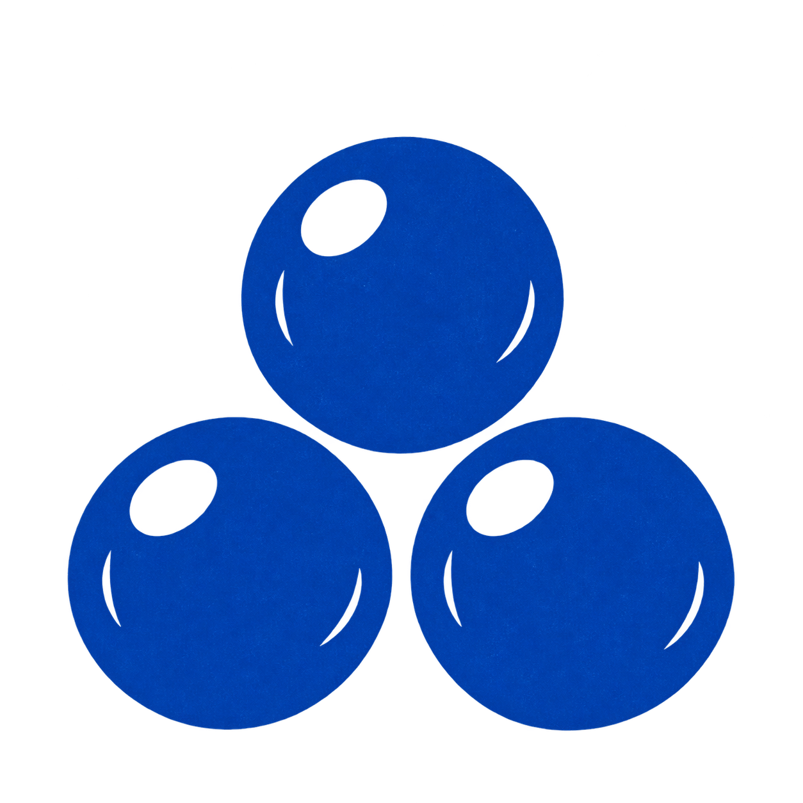

<h1></h1>

**AI Engineering & Applications**

<!-- Banner pendiente de selección por Jonathan. Las propuestas generadas anteriores no se usan. -->

My focus is **AI engineering and applications**: building systems that connect domain knowledge, data, and decision-making. I bring experience across **data engineering, business intelligence, analytics, and data governance**, alongside project work in RAG and agent workflows.

My work has ranged from implementing governance frameworks and managing metadata to building Customer 360 pipelines and turning CLTV analysis into business decisions. I now bring that foundation to AI applications, with an emphasis on structured knowledge, useful outputs, and explicit evaluation.

<h2> </h2>

| | Project & contribution |
| :--- | :--- |
| **01 / AI APPLICATIONS** | **Knowledge-based decision support · Master's project** Brought my governance background into a research prototype combining a **Knowledge Model, Knowledge Units, RAG, and specialized agents**. It connects organizational context, capability gaps, and retrieved knowledge to recommendations. Robustness evaluation identified limits in unsupported inference and counterfactual reasoning. |
| **02 / AGENT WORKFLOWS** | **Banking transaction disputes · Factored Hackathon** Contributed to a team project with a **LangGraph** workflow incorporating authentication, resumable confirmations, idempotency, action verification, and human escalation. [Explore project ↗](https://github.com/Valeriacv918/factored-hackathon-2026-epsilon-greedy) · [My contributions ↗](https://github.com/Valeriacv918/factored-hackathon-2026-epsilon-greedy/commits?author=Jona-24) |
| **03 / DATA ENGINEERING** | **Enterprise Customer 360 · Azure** Designed relational models and built tables, ETL, orchestration, quality controls, and data contracts using **Azure Synapse and SQL pool**. The initiative spanned **25 sources and the company's full customer portfolio**, bringing data definitions and validation into the implementation. |
| **04 / ANALYTICS & BI** | **Customer lifetime value · CLTV** Within the Azure initiative: evaluated and discussed the modeling approach, prepared data, adjusted the model, reviewed results, built visualizations, and presented business decisions informed by the analysis. |
| **05 / DATA GOVERNANCE** | **Governance frameworks & metadata management · Professional experience** Implemented data governance frameworks and worked on metadata management, data dictionaries, shared definitions, and model validation. My Customer 360 work also included quality controls and data contracts, connecting governance practices with data engineering and analytical use. |

<h2> </h2>

**Data engineering.** Relational modeling, ETL, orchestration, quality controls, and contracts with Azure Synapse and SQL pool; design and validation with Amazon Redshift and S3.

**Data governance.** Governance framework implementation, metadata management, data dictionaries, shared definitions, and model validation. This experience informs how I structure and document the data and knowledge used in analytical and AI systems.

**Analytics & business intelligence.** CLTV modeling, result review, visualization, and presentation of business decisions: experience connecting technical outputs with the people who use them.

<h2> </h2>

**Knowledge engineering · RAG · LangGraph · Sentence Transformers · FAISS**

My master's-level work in **Big Data and Analytics with an emphasis on AI** extends this experience into knowledge engineering and agent-based decision support. The research explores how domain knowledge can be structured, retrieved, and used in context, while evaluating where the resulting recommendations fall short.

[Semantic search with FAISS ↗](https://github.com/Jona-24/Actividad_FAISS) &nbsp; · &nbsp; [Data quality analysis ↗](https://github.com/Jona-24/calidad_de_datos_samples)

---

**My focus:** building useful AI applications on well-defined data, domain knowledge, and explicit evaluation.

